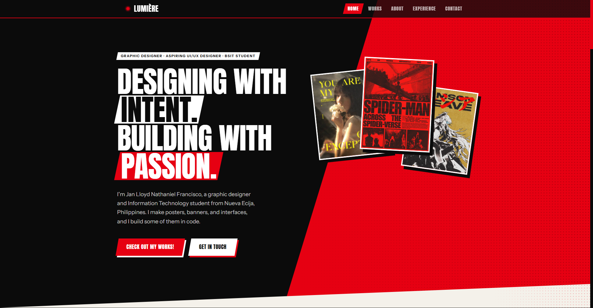

# Lumière

A personal one-page portfolio made in React as a Midterm Lab Project for **ITELEC 4100**.

**Live demo:** [https://lumiere-vite-portfolio.vercel.app](https://lumiere-vite-portfolio.vercel.app/)



## Sections

- **Home**: intro and calls to action
- **Works**: tabbed grid (All / UI/UX Design / Graphic Design). UI/UX projects open a full case study page at `/work/:slug`; graphic design pieces open in a lightbox
- **About**: bio, skills, and what I'm looking for
- **Experience**: organizations and roles
- **Contact**: email and social links

The visual direction is inspired by the Persona 5 Royal website: red, black, and white, skewed panels, halftone texture, and cut-out lettering for headings.

## Tech Stack

- [React 19](https://react.dev/) + [Vite](https://vite.dev/)
- [React Router 7](https://reactrouter.com/) for case study pages
- [Tailwind CSS v4](https://tailwindcss.com/) with custom CSS on top
- [Oxlint](https://oxc.rs/) for linting

## Getting Started

```bash
npm install
npm run dev
```

The app runs at `http://localhost:5173`.

### Other scripts

```bash
npm run build    # production build
npm run preview  # preview the production build locally
npm run lint     # lint the codebase
```

## Project Structure

```
src/
  components/   # Navbar, Hero, Works, About, Experience, Contact, cards, lightbox, ...
  pages/        # Home, CaseStudy, NotFound
  data/         # caseStudies (UI/UX), projects (graphic design), skills, experience, socials, nav
  hooks/        # useActiveSection (scroll-spy), useReveal (scroll animations)
  assets/img/   # optimized WebP images
```

### Editing case studies

Each UI/UX project lives in `src/data/caseStudies.js`. Lines marked `TODO` are drafts to check. To add a screenshot to the Final outputs section, import the image and set it as that output's `image` (an output with `image: null` shows a placeholder).

`vercel.json` rewrites every path to `index.html` so `/work/...` links work on refresh.

## License

MIT — see [LICENSE](LICENSE).
